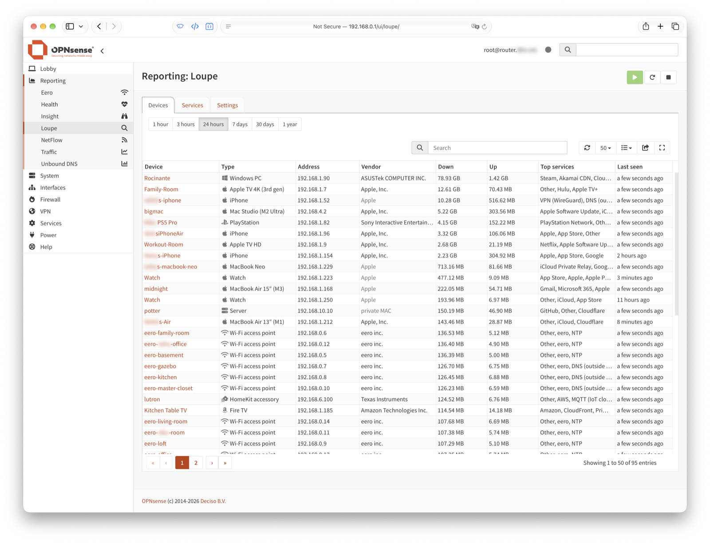
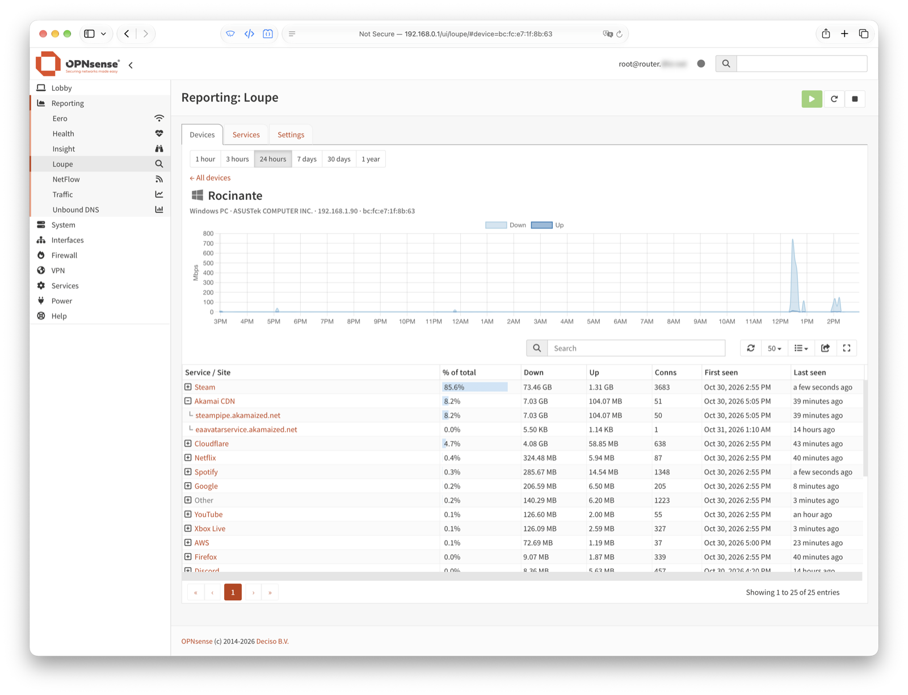
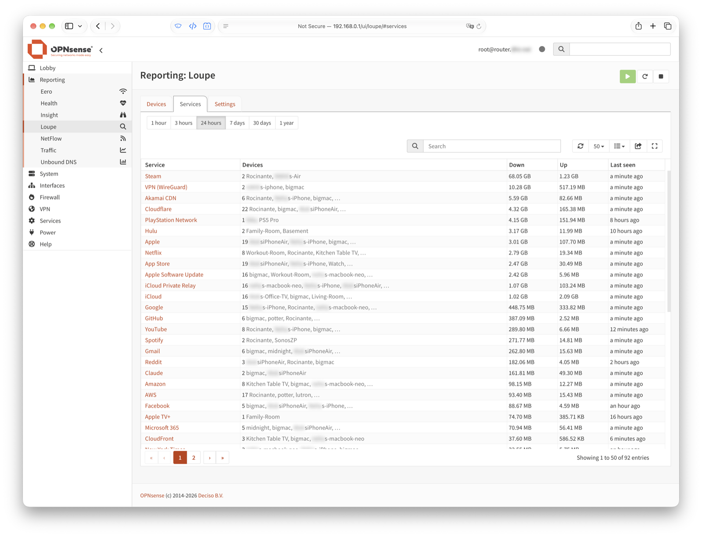
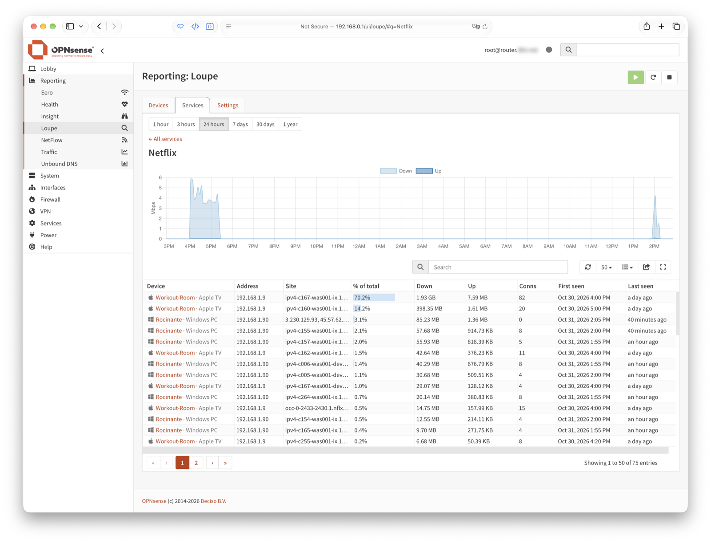
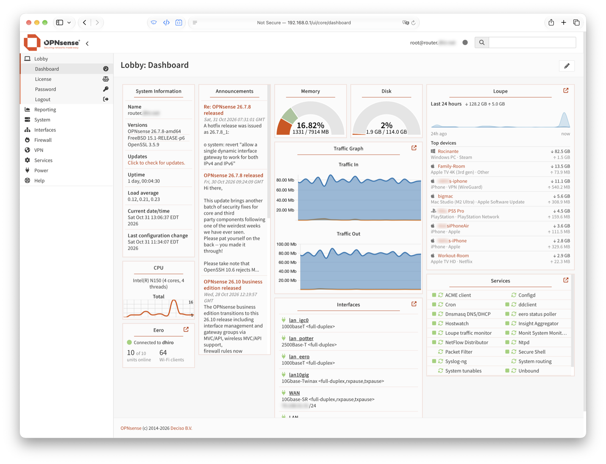
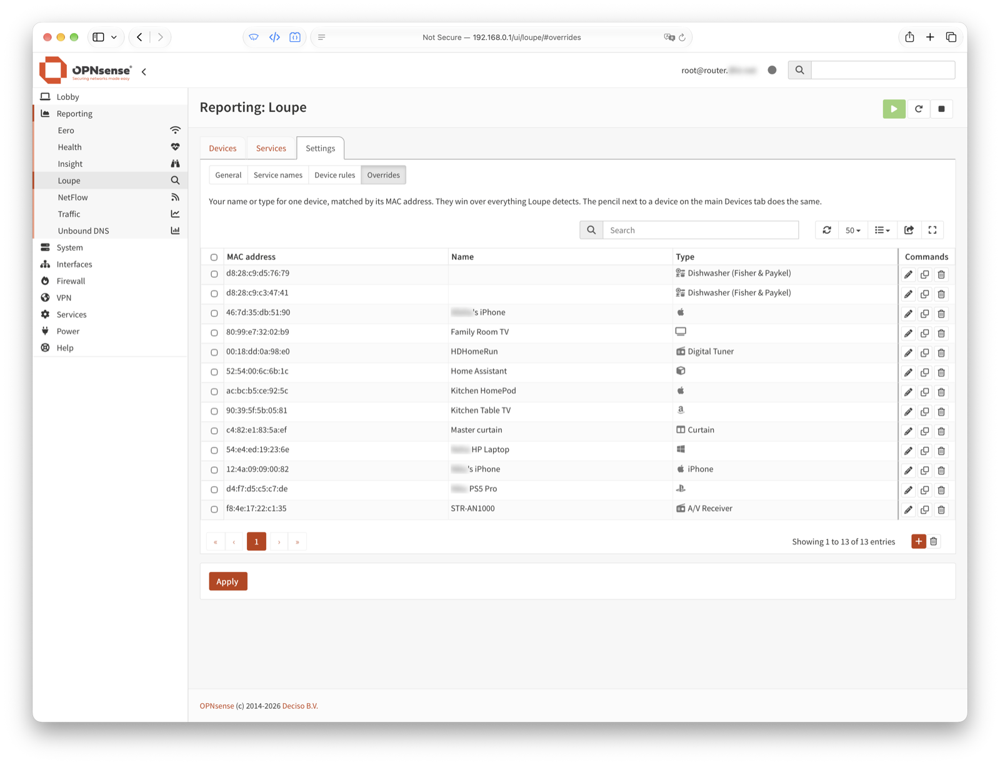
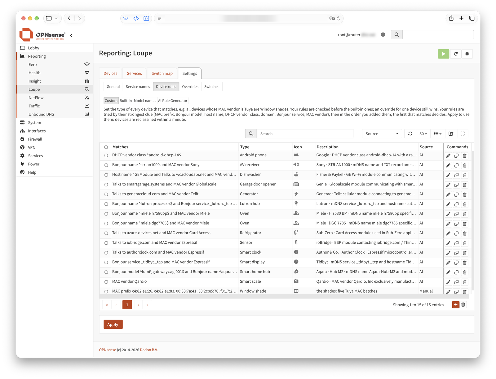

#  Loupe for OPNsense

Which device on your network talked to which site or service, how much data moved each way, and when — inside the OPNsense GUI.

Loupe answers questions like *"what was the PlayStation doing at 2 a.m.?"*, *"who's using all the bandwidth?"*, *"which devices talk to this address?"* and *"what is this unknown thing on my Wi-Fi?"* — with site and service names and exact upload/download bytes, per device.

Loupe is about each device's traffic to and from the internet. Traffic between your own devices isn't counted: on the same network it never reaches the router, and between networks (VLANs) Loupe leaves it out (firewall logs and Insight cover it).

**A clean device list is half the point.** Much of Loupe's work goes into telling you what each device actually is: a real name, a type and, where it can, the model, instead of an IP address or `ESP_3A1F2C`. What it can't work out on its own, [*Settings*](#settings) helps you fix: rename or retype a device, write rules that type a whole group at once, name model codes, take names from Home Assistant, or have an AI chat suggest rules for the devices it's unsure of.

When possible, devices are identified and named automatically. A layered, evidence-ranked rule engine weighs what each device says about itself — its Bonjour model, host name, DHCP fingerprint, MAC vendor and the services it uses — and goes with the strongest evidence, so you see *MacBook Air 15″ (M3)*, *Apple TV 4K (3rd gen)*, *PlayStation* or *Fire TV* instead of `192.0.2.57`. It ships with 162 rules covering 109 device types, follows each device by MAC address across address changes, and takes your own rules and corrections first.



## Features

- **Device identification**: a multi-tier rule engine names each device and works out what it is from the evidence it gives off, strongest first (see [Identifying devices](#identifying-devices)). Every identification shows the evidence it rests on.
- **Devices**: every device with its name, type and icon (e.g. *MacBook Air 15″ (M3)*, *Apple TV 4K*, *PlayStation*, *Smart plug*), vendor, bytes down and up, and its top three services, for the last hour, 3 hours, day, week, month or year.
- **Device detail**: a traffic chart over time, and what the device talked to: each service (*YouTube*, *Netflix*, *iCloud Private Relay*, *VPN (NordVPN)*…, unnamed traffic as *Other*), opening to the sites it used. Traffic that isn't the web shows its protocol and port (SSH, a game, a VPN).
- **Services**: every service the house used in the period, with the devices that used it. Open one, or search a service, site or address (`YouTube`, `playstation.net`, `203.0.113.7`), for a chart of its traffic over time and which devices used it, how much, and when.
- **Zoomable charts**: drag across a device's or a service's traffic chart to zoom into that stretch of time. The list below it follows the zoom, showing only the traffic in the time shown (a note says which span), so you can see what a spike was. *Reset zoom* goes back to the whole period.
- **Networks (VLANs)**: when Loupe watches more than one network, the device and service lists show each device's network and can be filtered to one or more. A device on several networks shows them all, and its page shows which network each service and site was used from. Network colours match *Reporting → Traffic*.
- **Sensible service names**: traffic named only for its CDN (Fastly, Akamai, CloudFront…), or with no name at all, takes the service the same device was using on the same server, marked *(same server)*. Streaming services that share another company's servers are told apart (Hulu on Disney's servers).
- **Your own names, types and icons**: rename a device, correct its type or pick its icon from any report page. Overrides follow the device by MAC address, and an icon picked for one device applies to every device of that type. Rules type many devices at once, e.g. every device whose MAC vendor is Tuya is a *Window shade*; a compound rule combines clues (MAC vendor Espressif *and* a host name starting `shelly`).
- **AI Rule Generator**: for the devices Loupe can only guess at, *Settings → Device rules → AI Rule Generator* builds a prompt to paste into any AI chat (Claude, ChatGPT, Gemini…), reads the rules out of its answer, shows what each would change on your network (flagging rules that reach other devices, change nothing or make a type vaguer), and saves the ones you tick. Loupe itself sends nothing anywhere.
- **Your own service names**: add domains (including patterns like `cdn-*.example.com`), addresses, ports or VPN app domains. *Settings → Service names / Device rules → Built-in* shows what Loupe ships with.
- **Dashboard widget**: the last 24 hours at a glance, with totals, an hourly chart and the top devices.

## Screenshots

All from a real home network, with people's names blurred. The address bar shows the router's IP address, not its host name, on purpose: it keeps the domain out of the pictures.

**A device**: its traffic over time, and each service it used, opening to its sites.



**Services**: every service the house used, and which devices used it.



**A service**: its traffic over time, and each device's share.



**Dashboard widget**: the last 24 hours and the top devices. Also shown here, at the bottom left, is the [eero plugin's](https://github.com/alokdhir/os-eero) widget.



**Your own names and types** for single devices, and **rules** for many at once.





## How it works

Loupe runs as a small service on the router and combines three sources:

1. **Names.** A kernel BPF filter passes only a handful of packet types to the service: the first packet of each TLS connection (the *ClientHello*, which carries the site name in plain text — SNI), QUIC/HTTP-3 *Initial* packets (decrypted with the public keys the protocol defines, RFC 9001/9369), DNS answers from the router to each device, DHCP requests, and mDNS/Bonjour announcements. Bulk traffic never reaches userland.
2. **Bytes.** Every connection through the router has a pf state with exact byte counters for both directions, recorded on the LAN side *before* NAT. Loupe reads the state table every 10 seconds and records the difference per device, server and port. pf keeps a closed connection around for at least 30–45 seconds, so every connection's final count is seen.
3. **Devices.** The MAC vendor (IEEE registry), the DHCP request (hostname, vendor class, parameter list), Bonjour announcements (Apple model identifiers like `Mac15,13`, AirPlay/Cast/printer services), the device's own DHCP lease name, and the services it talks to (`playstation.net` → PlayStation).

Each connection gets the name from its own handshake first, then from the DNS answer that device received for that address, then from any device's DNS answer. Service names come from a built-in map of ~300 domains (plus address-range and port fallbacks for nameless traffic) that you can extend in the settings; they are applied when reports are built, so changes cover all history.

### Data collection and retention

**Collecting.** Byte counts are read every 10 seconds and added up in memory per device, server, port and site name for each minute.

**Saving.** Once a minute they are written to SQLite (`/var/db/loupe/loupe.db`) in a single transaction, into three tables at once: per minute, per 5 minutes and per hour. There is no separate roll-up job, so the coarser tables are always current.

**Keeping and reading.** Old rows are pruned hourly.

| Detail | Retention | Reports use it for |
|---|---|---|
| Per minute | 4&nbsp;hours | periods up to 3 hours |
| Per 5 minutes | 30&nbsp;days | periods up to 2 days |
| Per hour | 1&nbsp;year | longer periods, charted by the day past 90 days |
| Sites seen | 30&nbsp;days | naming VPN tunnels, recognising devices by the domains they use |

Sites seen (the names in a device's DNS answers and its TLS and QUIC connections) are kept per device per day, as evidence for naming; reports don't list them. Retention for all but the minute rows is set under *Settings → General*: **Keep 5-minute detail**, **Keep hourly totals** and **Keep sites seen** (in days). Past 2 days, reports read hourly rows even where 5-minute rows still exist: a week or a month by the hour is plenty, and far fewer rows to read.

**Names.** Renaming a device or a service changes its whole history. Device names, types and icons are applied when a report is built. Service names are kept in daily summaries, which Loupe builds again, newest day first, after you change the service names or update Loupe; until it has finished, periods of 7 days and longer load slower, and the Devices and Services tabs show how many days are left.

### Speed over long periods

Naming traffic is most of what a report costs: a hundred devices make ~55,000 hourly traffic rows a day. So Loupe names each day once, in the background, and keeps per-day (and, for the last 3 days, per-hour) summaries by device, service and site, plus an index of site names for search. Reports of 7 days or longer read the summaries instead of the raw traffic: on an Intel N150, the 7-day and 30-day lists take ~0.01 s, and a service's traffic or a search over 7 days ~0.2–0.5 s (from ~1–3 s). Details and timings: [Performance](docs/DESIGN.md#performance).

The design, the alternatives considered and the known limits are in [docs/DESIGN.md](docs/DESIGN.md).

### Identifying devices

OPNsense's own reports, Insight (NetFlow) and Unbound's DNS reporting, name a device by looking up its IP address in DNS. That gives a name only if the DHCP server registered one, never a type, and the history belongs to the address: a new DHCP lease, a private Wi-Fi address or IPv6's rotating addresses split one device into several, or hand its history to another.

Loupe keys everything on the device's MAC address and works out what it is from what the device says about itself:

- **The model**, from Bonjour/mDNS: devices announce it (*Sonos One*, *Google Nest Mini*, *HP LaserJet Pro M404*); where it's a code (Apple's `Mac15,13`, `AppleTV14,1`), *Settings → Device rules → Model names* gives it a name (a lookup table; an AI chat can suggest the names there, from a prompt that carries only the codes, their maker and device type); a device that announces no model gets the one a rule gives it (*Model* in a device rule; the AI Rule Generator fills it in), named the same way; printers, speakers and Cast devices announce their services.
- **The category**, where a device states it: HomeKit's accessory category and Matter's device type (a thermostat, a lock, an oven), whatever the brand.
- **The name**, from the DHCP lease, the hostname the device sends, or its Bonjour name, preferring a real name over the placeholders phones with private addresses send (*iPhone*, *Mac*). A device that calls itself only by an ID or its maker and a serial (*Miele-0011223344556677*) is named after its model instead (*Miele Combi-Steam Oven XXL*). With *Home Assistant* set up (*Settings → General*, optional: its address and a long-lived access token), devices it knows by MAC address take the name you gave them there, and show their area; loupd fetches them every 10 minutes and keeps the last ones if Home Assistant is down. Your own names in Loupe still win.
- **The type and maker**, from DHCP fingerprints (vendor class and parameter list), the MAC vendor, and the services it talks to (`playstation.net` → PlayStation, `ring.com` → Ring device).
- **Your corrections**: a name, type or icon you set follows the device by MAC, and your rules type whole groups at once.

Each identification records the evidence it rests on, shown as a tooltip on the type.

**One device, several MACs.** A host whose traffic goes out under a bridge's MAC, an Apple TV moved from Wi-Fi to Ethernet, a laptop's dock and its Wi-Fi, a phone's new private address: Loupe links such MACs (the same address at the same time, the same Bonjour host name at the same time, or the same name used by related MACs at different times) and shows them as one device, with all their traffic.

### Why not just NetFlow / Insight?

OPNsense's NetFlow on a bridged LAN misses LAN→internet packets on ingress — uploads only show up after NAT, with the router's public address — so per-device upload totals in Insight are wrong. NetFlow also exports long connections only every 30 minutes and has no site names. Loupe's pf counters are exact in both directions and per device.

### Unbound's DNS reporting

To see which device looked up which name, use Unbound's report: it has per-query detail (query types, response times, blocklist results). Loupe doesn't list lookups. It keeps the sites each device was seen using only as evidence: the DNS answers a device received name that device's connections, the domains it uses help recognise its type, and VPN providers' domains label its tunnels. It also takes names from TLS and QUIC connection setup, so it names traffic from devices that bypass the router's DNS (DNS over HTTPS, hard-coded resolvers), and it works with dnsmasq as well as Unbound.

### Compared with ntopng and Zenarmor

Those are broader tools — deep packet inspection, alerts, policies, live flows — and they're good at it. Loupe does one narrower job: per-device history by site and service, with good device identification, built into OPNsense's own Reporting menu, free, and light enough to leave running on a small box.

## Settings

*Reporting → Loupe → Settings* has four pages: **General**, **Service names**, **Device rules** and **Overrides**. As elsewhere in OPNsense, changes to the lists are saved at once and used after *Apply*.

### General

- **Enable** and **Interfaces**: the LAN or VLAN interfaces your devices are on. With a bridge, choose the bridge; WAN and a bridge's member ports aren't listed.
- **Local networks**: usually empty, since your devices' networks come from the interfaces' addresses. A transparent bridge has no address, so Loupe then treats private addresses as local; list networks here if devices use others, such as public addresses or IPv6. See [Transparent bridges](#transparent-bridges).
- **Keep 5-minute detail** (30 days), **hourly totals** (365 days) and **sites seen** (30 days): how long each kind of data is kept.
- **Home Assistant (optional)**: its **Address** and an **Access token** (in Home Assistant: your profile → *Security* → *Long-lived access tokens* → *Create token*). Devices Home Assistant knows by MAC address take the name you gave them there, and their area shows on the device page. Most network integrations know the MAC; cloud ones (Tuya, for one) don't. Loupe only reads names and areas, every 10 minutes, and keeps the last ones if Home Assistant is down. Turn off **Verify certificate** for a self-signed certificate.

### Fix one device

The pencil next to a device's name or type sets its **name**, **type** or **icon**; *Settings → Overrides* lists them all. An override follows the device by MAC address, wins over everything Loupe detects, and takes effect immediately. An icon you pick applies to every device of that type. Clear the name and type to go back to what Loupe detects.

### Type many devices at once: Device rules → Custom

A rule sets the type of every device that matches it, e.g. *every device whose MAC vendor is Tuya is a Window shade*. Fill in one clue, or several for a compound rule (a device must match all of them; a clue with several values separated by commas matches any of them):

| Clue | Example |
|---|---|
| MAC vendor | `Tuya` (a whole word of the maker's name) |
| MAC prefix | `52:54:00` |
| MAC address | private (randomized) or not |
| Host name | `^kvm-[0-9a-f]{4}$` (regular expression) |
| Bonjour model | `^AppleTV` (regular expression) |
| Bonjour name | `^acme x1` (lower case, regular expression) |
| Bonjour service | `_hap._tcp` |
| Category code | `hap:9` (HomeKit thermostat), `matter:0x0301` |
| DHCP vendor class | `^udhcp` (regular expression) |
| Talks to | `nordvpn.com` (and its subdomains) |

Then the **Type** to show, an optional **Icon**, and an optional **Model** for devices that don't announce one (a device with no real name of its own is then named after it). Your rules are checked before the built-in ones; an override for one device still wins. They're tried by their strongest clue (MAC prefix, Bonjour model, host name, DHCP vendor class, domain, Bonjour service, MAC vendor), then in the order you added them, and the first that matches decides. After *Apply*, devices are reclassified within a minute. The **Source** filter shows the rules you wrote (*Manual*), the AI Rule Generator's (*AI*) or both.

*Device rules → Built-in* lists the rules Loupe ships with, in the order they're tried.

### Name model codes: Device rules → Model names

Many devices announce their model as a code (`Mac15,13`, `AppleTV14,1`). *Model names* maps a code to a name (*MacBook Air 15″ (M3)*). Add them by hand, or let an AI chat name them: the prompt lists only the codes your devices announce that have no name yet, each with its maker and device type, nothing else about your devices. Paste the answer back and press *Generate names*, tick *Name now* for the names to keep, and *Save and apply*.

### Ask an AI about unknown devices: Device rules → AI Rule Generator

For the devices Loupe can only guess at (no type, or a generic one such as *IoT device (ESP)*), it builds a prompt to paste into any AI chat (Claude, ChatGPT, Gemini…), ideally one that can search the web. The prompt carries what the devices announce and the domains they use, without MAC or IP addresses; Loupe itself sends nothing anywhere. Paste the answer back: Loupe reads the rules out of it (around prose, even from a reply that was cut off), shows what each would change on your network, and saves the ones you tick as your rules, marked *AI*. A rule that would also change devices outside its own row, changes nothing (it says why: you have it already, its devices already have that type…) or makes a type vaguer starts unticked. A rule the AI bases on a domain alone doesn't type phones, computers or devices with private MACs that use that domain, as for the built-in rules.

### Name services: Service names

*Service names → Custom* adds your own names and overrides the built-in ones (*Built-in* lists them). They apply to all history. Each entry is one **Kind**:

| Kind | Pattern | Names |
|---|---|---|
| Domain | `example.com`, or `cdn-*.example.com` (names under example.com whose next label starts with `cdn-`) | traffic to it and its subdomains |
| Address or range | `192.0.2.10`, `203.0.113.0/24`, `2001:db8::/48` | traffic to those servers, whatever their name says |
| Port | `tcp/8443`, `udp/51820` | traffic with no other name on that port |
| VPN app domain | `nordvpn.com` | a device that looks it up has its VPN tunnel labelled with this name |

Traffic named only for its CDN (Fastly, Akamai, CloudFront…), or with no name at all, takes the service the same device was using on the same server, marked *(same server)*.

## Rule files (for contributors)

How Loupe recognises devices is data, not code: [`data/devices.json`](src/opnsense/scripts/loupe/data/devices.json) (device rules, the icon and maker for each type) and [`data/services.json`](src/opnsense/scripts/loupe/data/services.json) (site and service names, address ranges, ports, VPN providers). Each device type is one entry, with the alternatives that identify it, one per line:

```json
{"type": "Printer", "any": [
 {"when": {"hostname": "(?i)printer|^brw|^epson"}, "example": {"hostname": "BRW0A1B2C"}},
 {"when": {"mdns_service": ["_ipp._tcp", "_ipps._tcp", "_printer._tcp"]}, "example": {"info": {"mdns_services": ["_ipp._tcp"]}}}
]}
```

A device is the type when any alternative matches. An alternative matches when all of its conditions do (`when`, or several in `all`) — a *compound* rule; a list value means *any of*. Your own rules (Settings) are single alternatives. Fields:

| Field | Matches |
|---|---|
| `mac_prefix` | start of the MAC address |
| `mdns_model` | a model the device announces over Bonjour (`model=`, `am=`, `md=`…), regex |
| `mdns_name` | a name it announces a Bonjour service under, lower case (`acme x100`), regex |
| `category` | a standard category it announces: HomeKit `hap:9` (thermostat) or Matter `matter:0x0301`, exact |
| `hostname` | its DHCP or Bonjour host name, regex |
| `mdns_service` | a Bonjour service it offers, exact (`_googlecast._tcp`) |
| `dhcp_vendor` | DHCP vendor class (option 60), regex |
| `dhcp_params` | start of the DHCP parameter request list (`1,121,3,6`) |
| `talks_to` | a domain it looked up or connected to, and its subdomains |
| `vendor` | a whole word in the maker's name for the MAC prefix |
| `private_mac` | `true` for a randomized (private) MAC |

Evidence is trusted in a fixed order — Bonjour model, Bonjour name, host name, hosting role, strong Bonjour services, standard category (exact, but generic: a Fire TV stays a Fire TV), DHCP vendor, DHCP fingerprint, domains it talks to (after the fingerprint: a phone running a smart-home app talks to the same cloud as the device), other Bonjour services, MAC maker, generic fingerprints too common to beat anything else (BusyBox's `udhcp`), a private MAC — and the first matching alternative wins (file order within a tier: specific makers come before general categories). Every type needs an entry in `types` with a [Font Awesome](https://fontawesome.com/icons) icon (the set OPNsense ships), and a `vendor` when only one maker makes it.

For your own network you don't need to edit these files: see [Settings](#settings).

**Adding a rule to the shipped file:** add it with an `example` — made-up evidence that should come out as your type (no real MACs or names) — then run the tests. They fail if the example lands on another type, or if your rule takes over another rule's example. `tools/fmtjson.py` keeps the files one entry per line.

## For other plugins

Other plugins can ask Loupe what it calls a device, without reading its database:

```sh
configctl loupe query identities 02:00:00:00:00:01,02:00:00:00:00:02
```

or `POST /api/loupe/report/identities` with `macs` (the same comma-separated list, at most 1024). The answer
covers the devices Loupe knows, with your overrides applied:

```json
{"version": 1, "devices": {"02:00:00:00:00:01": {"name": "Living room TV", "type": "Apple TV",
  "icon": "fa-brands fa-apple", "vendor": "Apple", "model": "AppleTV14,1"}}}
```

Fields may be empty strings; `icon` is a Font Awesome class (OPNsense ships Font Awesome). The format only
changes with a new `version`. [os-eero](https://github.com/alokdhir/os-eero) uses it to show device types
and icons for eero Wi-Fi clients.

## Footprint

On a gigabit home link, on an Intel N150, Loupe uses about 0.5% of one CPU core when the network is quiet, ~2% at around 175 Mbit/s, ~4% during a full-speed transfer, and about 75 MB of memory.

## Privacy

Loupe records which device talked to which site name and how much — not page contents, URLs or anything inside encrypted connections. Encrypted Client Hello (ECH), VPNs and relays (iCloud Private Relay) hide the real site; Loupe shows those as what they are. It's a tool for the network's owner; use it with the people on your network in mind.

The AI Rule Generator's prompt carries, for each device it asks about, what the device announces (MAC vendor, host name, Bonjour names and services, DHCP request) and the domains it used, never MAC or IP addresses, with possessive names (*Sam's iPhone*) blanked out. Loupe doesn't send it: you copy it into the AI chat you choose, so read it first (*Show prompt*) if your devices' names say more than you'd like.

In a workplace, tell people that their devices' traffic is recorded this way. Per-person browsing records are regulated in many places (for example the GDPR in the EU, and notice requirements in some US states); check what applies to you before turning it on.

## Install

Loupe installs from a package repository, [os-plugins](https://alokdhir.github.io/os-plugins/) (it isn't in the official plugin list: [plugins there wrap FreeBSD ports](https://github.com/opnsense/plugins/issues/5854)). Add the repository once, on the OPNsense box itself — from the console (option 8, *Shell*) or SSH, as root:

```sh
fetch -o /usr/local/etc/ssl/dhir-os-plugins.pub https://alokdhir.github.io/os-plugins/dhir-os-plugins.pub
fetch -o /usr/local/etc/pkg/repos/dhir-os-plugins.conf https://alokdhir.github.io/os-plugins/dhir-os-plugins.conf
pkg update
```

Then install **os-loupe** from **System → Firmware → Plugins** (or `pkg install os-loupe`); OPNsense shows its standard *Third party software* notice first, as it does for any package not from OPNsense. Updates arrive with OPNsense's own, under **System → Firmware → Updates**. The repository is signed: `pkg` checks everything it installs from it against the public key fetched above. The same repository has [os-eero](https://github.com/alokdhir/os-eero), the eero mesh Wi-Fi plugin.

Once installed, open **Reporting → Loupe → Settings**, tick *Enable* on the *General* page, choose the LAN interface(s) and press *Apply*.

Removing the plugin (or `pkg delete os-loupe`) keeps the traffic data in `/var/db/loupe` until you delete it. Requires OPNsense 26.x, on any architecture (the package holds no compiled code; it uses Python 3 with `cryptography` and `sqlite3`, both part of OPNsense).

For development, `ROUTER=user@router tools/deploy.sh` copies your working tree to a router over SSH and installs it there (`tools/install.sh`, without the package). Packages are built and published by `tools/publish.sh` in [os-plugins](https://github.com/alokdhir/os-plugins), the package repository; a changed plugin needs a new `PLUGIN_VERSION` or `PLUGIN_REVISION`.

The layout follows a plugin directory in [opnsense/plugins](https://github.com/opnsense/plugins) (`Makefile`, `pkg-descr`, `src/` installed under `/usr/local`), and is built as a package with that tree's tooling.


## Transparent bridges

Loupe works on a [transparent filtering bridge](https://docs.opnsense.org/manual/how-tos/transparent_bridge.html), where OPNsense sits inline with no address on the bridge and another router handles NAT, DHCP and DNS.

**Setup:** set up the bridge as the how-to describes, including its tunables (`net.link.bridge.pfil_bridge=1`, `net.link.bridge.pfil_member=0`). Loupe reads pf's states on the interface you select, so firewall rules have to match on the bridge, not its members. Then, under **Settings**, choose the *Bridge* interface and press *Apply*. If devices use anything other than private addresses, such as public addresses or global IPv6, list those networks in **Local networks**.

**How it differs from a router:**

- The box has to sit between the devices and their router. Between the modem and the router, it sees only the router's one NATed address.
- Loupe sees only traffic that crosses the bridge, not traffic between two devices on the same side.
- With Local networks empty, private addresses (`10.0.0.0/8`, `172.16.0.0/12`, `192.168.0.0/16`, `fc00::/7`) count as local, so traffic between two of them isn't counted, even across the bridge: a device reaching a private server beyond the bridge won't show. Listing your LAN in Local networks fixes that.
- Names come from what Loupe captures: TLS and QUIC server names, plain DNS answers, DHCP and Bonjour. It can't read another router's leases or its DNS cache.
- If your bridge has an address for some reason, Loupe treats it as a normal LAN: totals are right, but it misses most names and MAC addresses.

**Tested so far:** one setup, a VM built from the how-to with one client over IPv4, where Loupe's totals came within about 1% of the client's own counters. Not tested yet: IPv6, VLAN-tagged trunks (Loupe's capture filters don't match tagged frames, so expect missing names and MAC addresses there), real hardware and many devices. Reports are welcome.

## Tests

```sh
cd tests && python3 -m unittest test_tls test_quic test_pfstate test_store test_devid test_services test_rules test_airules test_hass
```

All test data is synthetic.

## License

BSD 2-Clause — see [LICENSE](LICENSE).

The magnifying-glass icon is from [Font Awesome Free](https://fontawesome.com) 6.7.1, licensed [CC BY 4.0](https://creativecommons.org/licenses/by/4.0/).
