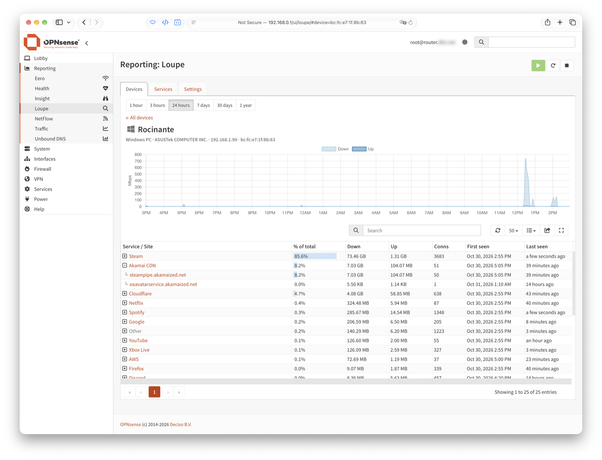
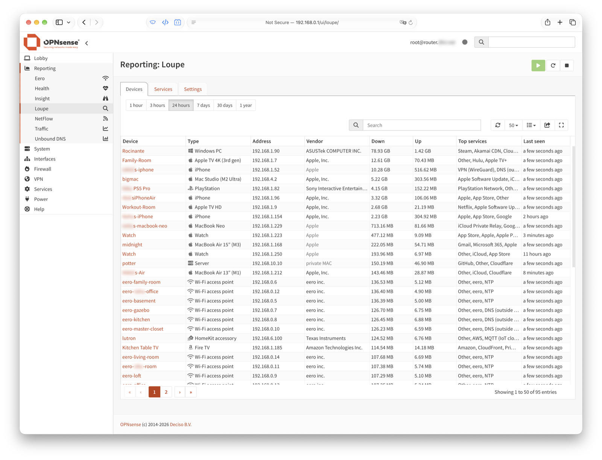
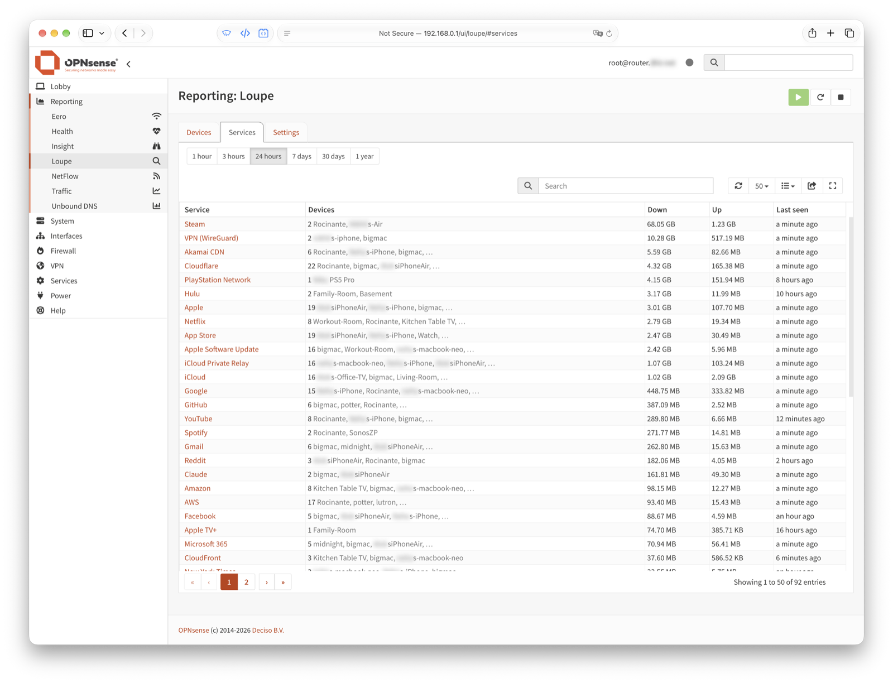
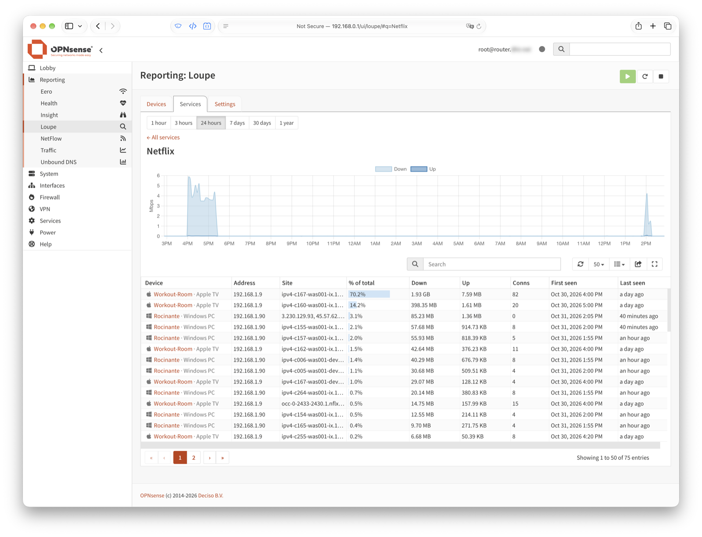
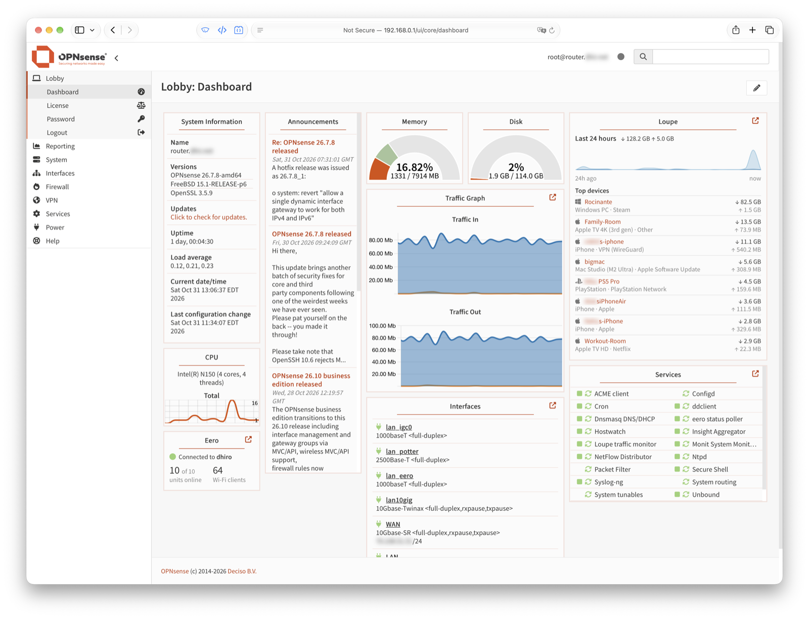
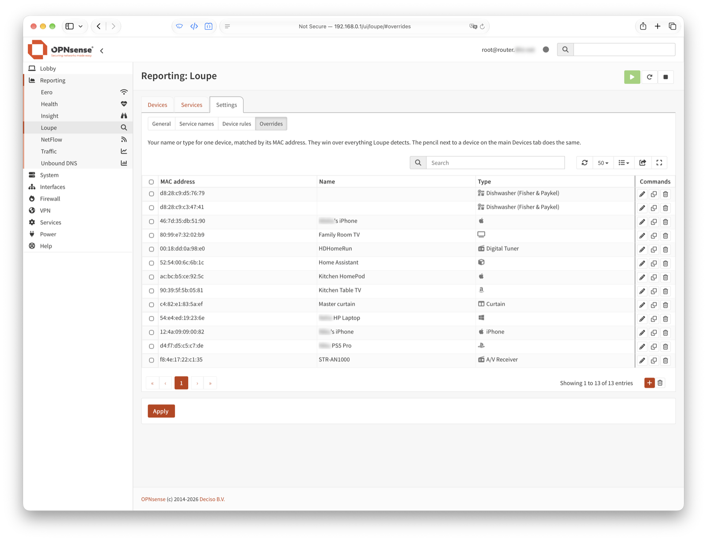
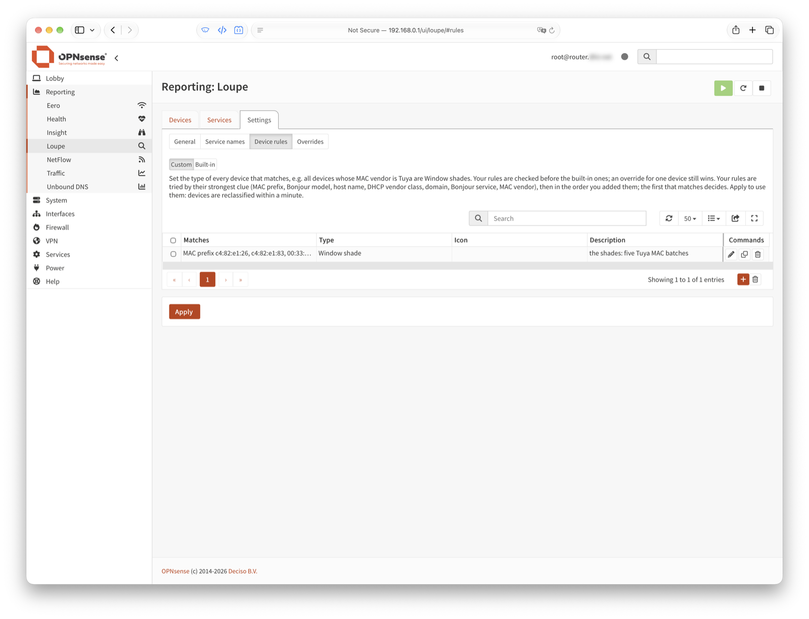

#  Loupe for OPNsense

Which device on your network talked to which site or service, how much data moved each way, and when — inside the OPNsense GUI.

Loupe answers questions like *"what was the PlayStation doing at 2 a.m.?"*, *"who's using all the bandwidth?"*, *"which devices talk to this address?"* and *"what is this unknown thing on my Wi-Fi?"* — with site and service names and exact upload/download bytes, per device.

Loupe is about each device's traffic to and from the internet. Traffic between your own devices isn't counted: on the same network it never reaches the router, and between networks (VLANs) Loupe leaves it out (firewall logs and Insight cover it).

Devices are identified automatically, not left as IP addresses. A layered, evidence-ranked rule engine weighs what each device says about itself — its Bonjour model, host name, DHCP fingerprint, MAC vendor and the services it uses — and goes with the strongest evidence, so you see *MacBook Air 15″ (M3)*, *Apple TV 4K (3rd gen)*, *PlayStation* or *Fire TV* instead of `192.0.2.57`. It ships with 135 rules covering 71 device types, follows each device by MAC address across address changes, and takes your own rules and corrections first.



## Features

- **Device identification**: a multi-tier rule engine names each device and works out what it is from the evidence it gives off, strongest first (see [Identifying devices](#identifying-devices)). Every identification shows the evidence it rests on.
- **Devices**: every device with its name, type and icon (e.g. *MacBook Air 15″ (M3)*, *Apple TV 4K*, *PlayStation*, *Smart plug*), vendor, bytes down and up, and its top three services, for the last hour, 3 hours, day, week, month or year.
- **Device detail**: a traffic chart over time, and what the device talked to: each service (*YouTube*, *Netflix*, *iCloud Private Relay*, *VPN (NordVPN)*…, unnamed traffic as *Other*), opening to the sites it used. Traffic that isn't the web shows its protocol and port (SSH, a game, a VPN).
- **Services**: every service the house used in the period, with the devices that used it. Open one, or search a service, site or address (`YouTube`, `playstation.net`, `203.0.113.7`), for a chart of its traffic over time and which devices used it, how much, and when.
- **Networks (VLANs)**: when Loupe watches more than one network, the device and service lists show each device's network and can be filtered to one or more. A device on several networks shows them all, and its page shows which network each service and site was used from. Network colours match *Reporting → Traffic*.
- **Sensible service names**: traffic named only for its CDN (Fastly, Akamai, CloudFront…), or with no name at all, takes the service the same device was using on the same server, marked *(same server)*. Streaming services that share another company's servers are told apart (Hulu on Disney's servers).
- **Your own names, types and icons**: rename a device, correct its type or pick its icon from any report page. Overrides follow the device by MAC address, and an icon picked for one device applies to every device of that type. Rules type many devices at once, e.g. every device whose MAC vendor is Tuya is a *Window shade*; a compound rule combines clues (MAC vendor Espressif *and* a host name starting `shelly`).
- **Your own service names**: add domains (including patterns like `cdn-*.example.com`), addresses, ports or VPN app domains. *Settings → Service names / Device rules → Built-in* shows what Loupe ships with.
- **Dashboard widget**: the last 24 hours at a glance, with totals, an hourly chart and the top devices.

## Screenshots

All from a real home network (names blurred).

**Devices**: every device, its type, vendor, traffic and top services.



**Services**: every service the house used, and which devices used it.



**A service**: its traffic over time, and each device's share.



**Dashboard widget**: the last 24 hours and the top devices (here next to the [eero plugin's](https://github.com/alokdhir/os-eero) widget).



**Your own names and types** for single devices, and **rules** for many at once.





## How it works

Loupe runs as a small service on the router and combines three sources:

1. **Names.** A kernel BPF filter passes only a handful of packet types to the service: the first packet of each TLS connection (the *ClientHello*, which carries the site name in plain text — SNI), QUIC/HTTP-3 *Initial* packets (decrypted with the public keys the protocol defines, RFC 9001/9369), DNS answers from the router to each device, DHCP requests, and mDNS/Bonjour announcements. Bulk traffic never reaches userland.
2. **Bytes.** Every connection through the router has a pf state with exact byte counters for both directions, recorded on the LAN side *before* NAT. Loupe reads the state table every 10 seconds and records the difference per device, server and port. pf keeps a closed connection around for at least 30–45 seconds, so every connection's final count is seen.
3. **Devices.** The MAC vendor (IEEE registry), the DHCP request (hostname, vendor class, parameter list), Bonjour announcements (Apple model identifiers like `Mac15,13`, AirPlay/Cast/printer services), the device's own DHCP lease name, and the services it talks to (`playstation.net` → PlayStation).

Each connection gets the name from its own handshake first, then from the DNS answer that device received for that address, then from any device's DNS answer. Service names come from a built-in map of ~300 domains (plus address-range and port fallbacks for nameless traffic) that you can extend in the settings; they are applied when reports are built, so changes cover all history.

### Data collection and retention

**Collecting.** Byte counts are read every 10 seconds and added up in memory per device, server, port and site name for each minute.

**Saving.** Once a minute they are written to SQLite (`/var/db/loupe/loupe.db`) in a single transaction, into three tables at once: per minute, per 5 minutes and per hour. There is no separate roll-up job, so the coarser tables are always current.

**Keeping and reading.** Old rows are pruned hourly.

| Detail | Retention | Reports use it for |
|---|---|---|
| Per minute | 4&nbsp;hours | periods up to 3 hours |
| Per 5 minutes | 30&nbsp;days | periods up to 2 days |
| Per hour | 1&nbsp;year | longer periods, charted by the day past 90 days |
| Site lookups | 30&nbsp;days | naming VPN tunnels, recognising devices by the domains they use |

Site lookups are kept per device per day, with a count and the first and last time seen. Retention for all but the minute rows is set under *Settings → General*: **Keep 5-minute detail**, **Keep hourly totals** and **Keep site lookups** (in days). Past 2 days, reports read hourly rows even where 5-minute rows still exist: a week or a month by the hour is plenty, and far fewer rows to read.

**Names.** Renaming a device or a service changes its whole history. Device names, types and icons are applied when a report is built. Service names are kept in daily summaries, which Loupe builds again, newest day first, after you change the service names or update Loupe; until it has finished, periods of 7 days and longer load slower, and the Devices and Services tabs show how many days are left.

### Speed over long periods

Naming traffic is most of what a report costs: a hundred devices make ~55,000 hourly traffic rows a day. So Loupe names each day once, in the background, and keeps per-day (and, for the last 3 days, per-hour) summaries by device, service and site, plus an index of site names for search. Reports of 7 days or longer read the summaries instead of the raw traffic: on an Intel N150, the 7-day and 30-day lists take ~0.01 s, and a service's traffic or a search over 7 days ~0.2–0.5 s (from ~1–3 s). Details and timings: [Performance](docs/DESIGN.md#performance).

The design, the alternatives considered and the known limits are in [docs/DESIGN.md](docs/DESIGN.md).

### Identifying devices

OPNsense's own reports, Insight (NetFlow) and Unbound's DNS reporting, name a device by looking up its IP address in DNS. That gives a name only if the DHCP server registered one, never a type, and the history belongs to the address: a new DHCP lease, a private Wi-Fi address or IPv6's rotating addresses split one device into several, or hand its history to another.

Loupe keys everything on the device's MAC address and works out what it is from what the device says about itself:

- **The model**, from Bonjour/mDNS: Apple devices announce an identifier (`Mac15,13`, `AppleTV14,1`) that Loupe turns into *MacBook Air 15″ (M3)* or *Apple TV 4K (3rd gen)*; printers, speakers and Cast devices announce their services.
- **The name**, from the DHCP lease, the hostname the device sends, or its Bonjour name, preferring a real name over the placeholders phones with private addresses send (*iPhone*, *Mac*).
- **The type and maker**, from DHCP fingerprints (vendor class and parameter list), the MAC vendor, and the services it talks to (`playstation.net` → PlayStation, `ring.com` → Ring device).
- **Your corrections**: a name, type or icon you set follows the device by MAC, and your rules type whole groups at once.

Each identification records the evidence it rests on, shown as a tooltip on the type.

### Why not just NetFlow / Insight?

OPNsense's NetFlow on a bridged LAN misses LAN→internet packets on ingress — uploads only show up after NAT, with the router's public address — so per-device upload totals in Insight are wrong. NetFlow also exports long connections only every 30 minutes and has no site names. Loupe's pf counters are exact in both directions and per device.

### Site lookups and Unbound's DNS reporting

Both show which device looked up which name, but Loupe needs its own record anyway: it uses the DNS answers a device received to name that device's connections, the domains it talks to to recognise its type, and VPN providers' domains to label its tunnels. Loupe also sees names in TLS and QUIC connection setup, so it catches devices that bypass the router's DNS (DNS over HTTPS, hard-coded resolvers), it works with dnsmasq as well as Unbound, it ties lookups to the device by MAC, and it keeps them 30 days (Unbound's report keeps 7). Unbound's report is the place for per-query detail: query types, response times and blocklist results.

### Compared with ntopng and Zenarmor

Those are broader tools — deep packet inspection, alerts, policies, live flows — and they're good at it. Loupe does one narrower job: per-device history by site and service, with good device identification, built into OPNsense's own Reporting menu, free, and light enough to leave running on a small box.

## Device rules

How Loupe recognises devices is data, not code: [`data/devices.json`](src/opnsense/scripts/loupe/data/devices.json) (device rules, the icon and maker for each type, Apple model names) and [`data/services.json`](src/opnsense/scripts/loupe/data/services.json) (site and service names, address ranges, ports, VPN providers). One entry per line:

```json
{"when": {"hostname": "(?i)^kvm-[0-9a-f]{4}$"}, "type": "NanoKVM", "example": {"hostname": "kvm-0a1b"}}
```

A rule matches when all of its conditions do (`when`, or several in `all`) — a *compound* rule; a list value means *any of*. Fields:

| Field | Matches |
|---|---|
| `mac_prefix` | start of the MAC address |
| `mdns_model` | a model the device announces over Bonjour (`model=`, `am=`, `md=`…), regex |
| `hostname` | its DHCP or Bonjour host name, regex |
| `mdns_service` | a Bonjour service it offers, exact (`_googlecast._tcp`) |
| `dhcp_vendor` | DHCP vendor class (option 60), regex |
| `dhcp_params` | start of the DHCP parameter request list (`1,121,3,6`) |
| `talks_to` | a domain it looked up or connected to, and its subdomains |
| `vendor` | a whole word in the maker's name for the MAC prefix |
| `private_mac` | `true` for a randomized (private) MAC |

Evidence is trusted in a fixed order — Bonjour model, host name, hosting role, strong Bonjour services, DHCP vendor, DHCP fingerprint, domains it talks to (after the fingerprint: a phone running a smart-home app talks to the same cloud as the device), other Bonjour services, MAC maker, generic fingerprints too common to beat anything else (BusyBox's `udhcp`), a private MAC — and the first matching rule wins (file order within a tier). Every type needs an entry in `types` with a [Font Awesome](https://fontawesome.com/icons) icon (the set OPNsense ships), and a `vendor` when only one maker makes it.

**For your own network** you don't need to edit these files: *Settings → Device rules* takes rules in the GUI (checked before the shipped ones; fill in one clue or several for a compound rule; your rules are tried by their strongest clue, then in the order you added them, and the first that matches decides), and *Settings → Service names* takes your own names.

**Adding a rule to the shipped file:** add it with an `example` — made-up evidence that should come out as your type (no real MACs or names) — then run the tests. They fail if the example lands on another type, or if your rule takes over another rule's example. `tools/fmtjson.py` keeps the files one entry per line.

## For other plugins

Other plugins can ask Loupe what it calls a device, without reading its database:

```sh
configctl loupe query identities 02:00:00:00:00:01,02:00:00:00:00:02
```

or `POST /api/loupe/report/identities` with `macs` (the same comma-separated list, at most 1024). The answer
covers the devices Loupe knows, with your overrides applied:

```json
{"version": 1, "devices": {"02:00:00:00:00:01": {"name": "Living room TV", "type": "Apple TV",
  "icon": "fa-brands fa-apple", "vendor": "Apple", "model": "AppleTV14,1"}}}
```

Fields may be empty strings; `icon` is a Font Awesome class (OPNsense ships Font Awesome). The format only
changes with a new `version`. [os-eero](https://github.com/alokdhir/os-eero) uses it to show device types
and icons for eero Wi-Fi clients.

## Footprint

On a gigabit home link running on an Intel N150: about 0.5% of one CPU core idle, ~4% during a full-speed transfer, and 30–50 MB of memory.

## Privacy

Loupe records which device talked to which site name and how much — not page contents, URLs or anything inside encrypted connections. Encrypted Client Hello (ECH), VPNs and relays (iCloud Private Relay) hide the real site; Loupe shows those as what they are. It's a tool for the network's owner; use it with the people on your network in mind.

In a workplace, tell people that their devices' traffic is recorded this way. Per-person browsing records are regulated in many places (for example the GDPR in the EU, and notice requirements in some US states); check what applies to you before turning it on.

## Install

Loupe is not in the official plugin list yet. To try it, install it from this repository on the OPNsense box itself — from the console (option 8, *Shell*) or SSH, as root:

```sh
fetch -o - https://github.com/alokdhir/os-loupe/archive/refs/heads/master.tar.gz | tar -xzf - -C /tmp
sh /tmp/os-loupe-master/tools/install.sh
```

or, where `git` is installed (`pkg install git`), which makes updating a `git pull`:

```sh
git clone https://github.com/alokdhir/os-loupe /root/os-loupe
sh /root/os-loupe/tools/install.sh                                   # install
cd /root/os-loupe && git pull && sh tools/install.sh                 # update
```

Then open **Reporting → Loupe → Settings**, tick *Enable* on the *General* page, choose the LAN interface(s) and press *Apply*.

`sh tools/uninstall.sh` removes it again; the traffic data in `/var/db/loupe` is kept until you delete it. Requires OPNsense 26.x (Python 3 with `cryptography` and `sqlite3`, both present by default).

For development, `ROUTER=user@router tools/deploy.sh` copies your working tree to a router over SSH and runs the same installer there.

The layout follows a plugin directory in [opnsense/plugins](https://github.com/opnsense/plugins) (`Makefile`, `pkg-descr`, `src/` installed under `/usr/local`), so it can be built as a package from that tree.

## Tests

```sh
cd tests && python3 -m unittest test_tls test_quic test_pfstate test_store test_devid test_services test_rules
```

All test data is synthetic.

## License

BSD 2-Clause — see [LICENSE](LICENSE).

The magnifying-glass icon is from [Font Awesome Free](https://fontawesome.com) 6.7.1, licensed [CC BY 4.0](https://creativecommons.org/licenses/by/4.0/).
