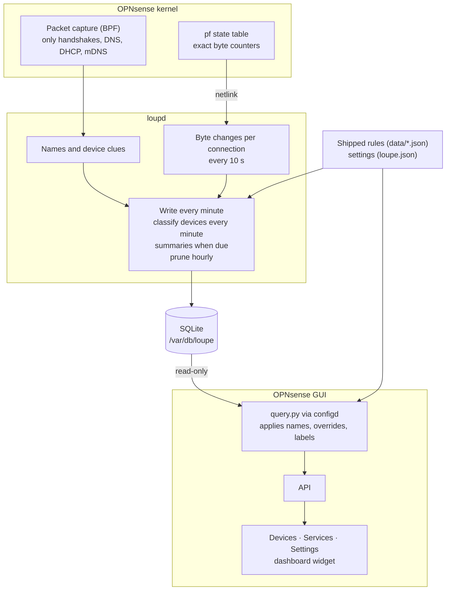

# Loupe design notes

What Loupe does, how, what was considered instead, and what is known not to work yet. For contributors and reviewers; the README is the user-facing overview.

## Goal

Per-device history of *who talked to what, how much, and when* — device → site/service, bytes each way, over time — inside the OPNsense GUI, light enough to leave running on a small box.

Non-goals: blocking or policy (that is the firewall's job), alerts, deep packet inspection, live per-packet views. Zenarmor and ntopng cover those.

## Overview

## Data sources

Everything Loupe knows comes from these. Required ones stop Loupe from working if missing; optional ones only cost names or detail.

| Source | Gives | When | Needed |
|---|---|---|---|
| pf state table (pf's netlink interface) | bytes and packets per connection, both directions, before NAT | every 10 s | required |
| Packet capture (BPF) on the selected interfaces | TLS SNI and QUIC names, DNS answers sent to devices, DHCP requests (host name, vendor class, parameter list), mDNS (host names, models, services) | continuously | required |
| ARP and IPv6 neighbour tables (sysctl, as `arp -an` / `ndp -an` show them) | IP → MAC, to tie traffic to a device | every 60 s | required |
| Interface addresses (`getifaddrs()`) | which networks are local | at start, every minute | required |
| Unbound cache (`dump_cache` over Unbound's TLS control port) | names for connections opened before Loupe started | at start | optional (Unbound) |
| DHCP leases and fixed entries: dnsmasq (`/var/db/dnsmasq.leases`, `/var/etc/dnsmasq-hosts`), Kea (`/var/db/kea/kea-leases4.csv`, reservations in `kea-dhcp4.conf`), ISC dhcpd (`dhcpd.leases`, `host` entries in `dhcpd.conf`) | device names | every minute | optional; a server's fixed entries are read only while it has a lease file (Kea is installed with a sample config) |
| IEEE vendor list (`/usr/local/opnsense/contrib/ieee/oui.csv`, shipped with OPNsense) | MAC maker | at start | optional |
| Settings (`/usr/local/etc/loupe.json`, from the OPNsense config via a template) | interfaces, retention, your service and device names | daemon: at start (Apply restarts it); reports: every query | required |
| Shipped rules (`data/devices.json`, `data/services.json`) | device types, icons, makers, Apple model names; service names, address ranges, ports, VPN providers | at start / every query | required |

## Bytes: pf state counters

Every connection through the router has a pf state with exact packet and byte counters for both directions. On the LAN interface that state is recorded **before NAT**, with the device's own address. `lib/pfstate.py` reads the state table every 10 seconds over pf's generic netlink family (`pfctl`, the interface `pfctl` itself uses; `lib/pfnl.py`), keeps states whose `origif` is a selected interface and that have exactly one local endpoint, and records the change in each state's counters since the last read. The first read after start is only a baseline, so restarts never double count.

pf keeps a closed state for at least its close timeouts (TCP fin-wait 45 s, single-packet UDP 30 s), longer than the 10-second poll, so every connection's final counters are seen. Counters are `initiator:responder`; the device-opened direction decides which side is "up".

Measured on the development box, Loupe's totals matched the WAN interface counters: upload exact, download ~96% (the rest is traffic that never had a LAN-side state, such as the router's own).

## Names

Each connection is named, in order of trust:

1. its own TLS ClientHello (SNI) or QUIC Initial (decrypted with the public RFC 9001 / 9369 keys), matched by the exact 4-tuple;
2. the DNS answer *that device* received for the server address;
3. any device's DNS answer for that address (`dns*`).

The kernel BPF filter (`capture.py`) passes only handshake starts, the continuation segment of large ClientHellos, DNS answers, DHCP client messages and mDNS; bulk traffic never reaches userland. At start, Unbound's cache (`unbound-control dump_cache`) seeds the DNS map so connections opened before Loupe started still get names.

A state's name is fixed once given, so a later, unrelated DNS answer for the same address does not rename it.

## Devices

A device is its MAC address (IP as fallback). Clues: the MAC vendor (OPNsense's IEEE list), the private-MAC bit, DHCP host name / vendor class / parameter list, mDNS host names, models and services, and the domains it talks to.

Identification is **data, not code**: `data/devices.json` holds the rules, the icon and maker per type, and Apple model names; `lib/devid.py` only matches them, in a fixed order of trust (mDNS model → host name → hosting role → strong mDNS services → DHCP vendor → DHCP fingerprint → domains it talks to → other mDNS services → MAC vendor → private MAC). Users add their own rules in *Settings → Device rules* (`rules` in `loupe.json`); they are checked before all shipped rules, invalid patterns are refused when saved and skipped with a log line if they get through, and per-device overrides still win at report time. Every shipped rule carries synthetic example evidence that the tests run through the engine, which catches typos and rules that take over other rules' devices.

## Storage

SQLite at `/var/db/loupe/loupe.db`, WAL mode: `loupd` is the only writer; `query.py` opens it read-only from configd.

- `flows_1m` / `flows_5m` / `flows_1h`: per bucket, device (address and MAC), server, port, protocol and name — bytes up/down, packets, connections, and when loupd last added to the row. All three are written in the same transaction each minute (no separate roll-up). Kept 4 hours / 30 days / 365 days (the last two are settings).
- `lookups`: names each device looked up or connected to, per day and device (address and MAC), including ones that moved no data. 30 days by default.
- `devices`: detected facts only.
- `services_1h` / `services_1d`: per hour (the last 3 days) and per local day, device and service — bytes, connections, last seen. `sites_1d`: per local day, device, site (server name, or address) and service — bytes, connections, first and last seen, the site's addresses, and whether its service was inferred. `site_names`: each site, service and address in `sites_1d`, and the last day it was there. `day_names`: the evidence each day's traffic was named with. `summary_days`: when each day was built, and with which service map. loupd builds them from `flows_1h` (see Performance); the daily rows and evidence are pruned with `flows_1h`.

Device names, types and icons are applied **when a report is built**, so editing or resetting a device shows everywhere immediately. Service names are stored in the summaries; when the service map changes (your entries, or the shipped file in an update) loupd builds the days again, newest first, and the reports name traffic directly until a day is rebuilt — see Performance.

## GUI

Standard OPNsense MVC: one page with tabs (Devices, Services, Settings), UIBootgrid grids fed by `searchRecordsetBase`, the standard dialog and form partials, a dashboard widget, configd actions for the service and for queries, templates for `rc.conf.d` and `loupe.json`, and `rc.d` running the daemon under `daemon -r`.

## Performance

The device and service lists show a row per device or service, but they're made from traffic rows: one per device, server, port and name in each time slot. A phone or laptop talks to thousands of servers a week, so on a home network of about a hundred devices a day adds ~55,000 hourly rows, and a week sums to ~78,000 device/server/port/name combinations. Each needs a service name before it can be added up, and naming is most of what a report costs. Loupe names traffic once, in loupd, and keeps the result.

### Naming by day

Some traffic is named from other traffic: nameless traffic takes the service of named traffic between the same device and server, and a VPN tunnel takes the provider whose domain the device looked up. The evidence for that is gathered per local day — every report, whatever its period, names traffic with the evidence of the day it happened. So the same traffic has the same name in the 1-hour, 24-hour and 30-day views, and an hour of a thermostat's nameless traffic is named from the lookup it made that morning.

loupd builds each day from `flows_1h` with the reports' naming code (`build_day` in `lib/report.py`) and stores:

- `services_1h`: per hour, device and service (the last 3 days, for periods up to 48 hours);
- `services_1d`: per day, device and service;
- `sites_1d`: per day, device, site and service: what a services list row shows when clicked, and what the services search matches. Today's holds the hours that had ended when loupd built it;
- `site_names`: each site, service and address `sites_1d` holds, with the last day it was there (thousands of rows a year): the services search finds what matches its text here, then reads only those sites' and services' rows by index. Rows are only added or moved later, so a renamed service leaves a row that makes a search look further but never shows;
- `day_names`: the day's evidence — which services were named on each device/server pair, which pairs carry VPN tunnels, which VPN apps each device used.

Today is built every 10 minutes (~0.6 s), each day once more after it ends, and every day again when the service map changes: each day records a fingerprint of the map it was built with (`summary_days`), and days with another fingerprint are built again, newest first, with at most ~1 s of work a minute. Until a day is rebuilt the short periods, the device page and the services drill-down and search gather that day's evidence themselves (slower, same names), and the long-period lists show the day as it was built. While days wait, the Devices and Services tabs say so under the period buttons (`query.py summary`: days built and waiting), so the slower periods don't look like a fault.

### Where each report gets its rows

| Report | Made from | Time (Intel N150, ~100 devices) |
|---|---|---|
| Lists, up to 2 days (1 h, 3 h, 24 h, 48 h) | stored hours, plus the minutes since loupd's last build named with the stored evidence | ~0.12–0.17 s |
| Lists, longer (7 days, 30 days, a year) | stored days | ~0.01 s with a few weeks of history; it grows with the days in the period (a synthetic year, ~100 devices: ~1.5 s on a desktop) |
| Sorting, paging, searching a list | configd's cached copy | ~0.04 s |
| Device page | that device's traffic rows, named with its stored evidence, each device/server/port/name once | ~0.05 s (1 h), ~0.5 s (7 days) |
| A service's traffic, services search: up to 2 days | all traffic rows in the period, a day at a time | ~0.8 s (24 h) |
| A service's traffic, services search: longer | stored sites (a click: by the row's index; a search: the sites and services `site_names` matches, by index), plus today's traffic since loupd's last build, named here | 7 days: ~0.5 s a click, ~0.2 s a search (was ~2.8 s and ~0.9 s). A synthetic year on a desktop: ~0.1–0.4 s a click or search, ~1.5 s for a search matching sites every device used every day, ~7 s for one matching a third of all traffic (it reads most of it) |

The short lists are a rolling window, current to the minute. The long ones are whole local days: "7 days" is today and the six days before it, and today is up to 10 minutes behind. A service's traffic and the services search cover the same days as the list, and are current to the minute: today's hours since loupd's last build are named when asked for.

### Summary indexes

| Index | Serves |
|---|---|
| `services_1d` primary key (day, ip, mac, service) | the long lists (a range of days) |
| `services_1d_service` (service, day) | the services search: the traffic of the services it matched |
| `sites_1d_day` (day) | loupd replacing a day |
| `sites_1d_listed` (lower(service, or site when it has none), day) | a click on a services list row |
| `sites_1d_site` (site, day) | the services search: the sites it matched |
| `site_names` primary key (site, named, service, server) | loupd adding a day's names; the search reads the whole table (thousands of rows) |

`sites_1d` is a rowid table, unlike the others: each of its three indexes would otherwise carry the whole six-column key, nearly doubling its size.

### Rebuilding the summaries

The summaries hold names and what the reports read, so they're built again whenever either changes: `SUMMARY_VERSION` in `lib/report.py` is part of each day's fingerprint. Raise it when the naming code changes or a summary table gains something loupd must fill in for past days (a new table or column); loupd then builds every day again, newest first. New indexes don't need it (SQLite builds them when loupd opens the database). A rebuild goes about one day of history a minute (as seen on an N150), so ~17 minutes for 17 days and ~6 hours for a full year; the Devices and Services tabs show the days left. On a desktop, the site summary made naming a day ~35% slower (0.17 → 0.23 s) and the names table made building and writing it ~15% slower (0.39 → 0.45 s); not measured on an N150.

### Cached lists

The grids sort, page and search on the server, so each click and keystroke asks for the report again. The device and service lists, a service's traffic and the services search go through a configd action with a 60-second cache (`loupe list`), which configd keys by its arguments (report, period, text, networks). The page asks for a fresh copy (configd's `!` prefix) when it opens, when the period changes and after a save; the requests in between get the cached one. A service's two grids (traffic, lookups) show the same report: the second asks once the first has loaded, and gets the cached copy. A device's page works the same way: its header and chart ask for a fresh copy of the device report, and its four grids ask once that has loaded, so opening a device runs the report once rather than five times.

### Naming traffic

- **Address ranges.** Nameless traffic is named by who owns the server's address (Apple, Google…). The ranges are held per prefix length (`AddressTable` in `lib/services.py`): one dictionary lookup per length rather than a test against each range, and the answer is kept per address, since a report asks about the same servers many times. The result is the same as taking the first matching range in the list.
- **Evidence for recent minutes.** Traffic loupd hasn't built yet is named with the day's stored evidence plus its own (`Namer` in `lib/report.py`), so a report reads those rows once and only the lookups made since the last build; traffic loupd has built uses the stored evidence alone.

### Storage growth

`flows_1h` grows ~14 MB a day with its indexes, ~5.3 GB at the default 365-day retention; `day_names` ~0.4 MB a day (~7,000 rows), `services_1d` less than that. `sites_1d` ~1.4 MB a day with its indexes (measured over 4 days on a home network of about a hundred devices; ~5.8 MB on synthetic traffic where every device uses every site), plus ~25% for the indexes the search uses (by site in `sites_1d`, by service in `services_1d`); `site_names` well under 1 MB a year. The lists, a service's traffic and the services search don't read `flows_1h` once the summaries are built, so a shorter retention mainly limits how far back the device page and a rebuild can go.

## Alternatives considered

| Option | Why not |
|---|---|
| **NetFlow / Insight (flowd)** | On a bridged LAN it misses LAN→internet packets on ingress, so uploads appear only after NAT with the router's address and per-device upload is wrong; long flows are exported every 30 minutes; no names. |
| **Full packet capture / DPI** | Far more CPU per byte, and records more than the goal needs (privacy). |
| **pflog** | Logs rule matches, not byte counts. |
| **Suricata EVE flow records** | Heavy to run just for accounting; Suricata is optional and often off. |
| **Zenarmor / ntopng** | Broader products with their own engines; Loupe aims to be small and native. |
| **DuckDB instead of SQLite** | Built for large analytic scans (OPNsense ships it for Unbound reporting); but no other process can read the file while loupd writes to it, and Loupe's data is small. |

## Footprint

On a gigabit home link running on an Intel N150: about 0.5–0.8% of one core idle, a few percent during a full-speed transfer, 30–50 MB of memory. Database growth is still being measured over a full month.

## Known limits

- **Hidden names:** Encrypted Client Hello, DNS-over-HTTPS that bypasses the router, VPNs and relays (iCloud Private Relay) hide the real site. Loupe labels VPNs (and the provider when the device looked up its domain) and Private Relay as what they are.
- **Shared servers:** traffic with no name, or named only for its hosting company (Fastly, Akamai, CloudFront…), takes the service of the device's other traffic to the same server that day, when that is exactly one service; reports mark it "(same server)". A device that looks up a name once and keeps using the server for days has its traffic on the later days shown as "Other" (~0.2% of bytes on a test week). A video vendor's domain on its own servers (e.g. `lura.live` on Google Cloud) stays "Other".
- **Containers and VMs behind one MAC** look like one device; a distro rule can be swayed by a container's update traffic.
- **Private MACs** can rotate, which splits a device's history until the user names it or turns the private address off for the network.
- **Multicast and broadcast** traffic is not counted.
- **Traffic that never crosses the router** (device to device on the LAN) is invisible by design.
- **Traffic between local networks** (VLAN to VLAN) crosses the router but isn't counted: Loupe tracks devices' internet traffic, and same-network traffic can't be seen anyway, so a partial local view would mislead. Firewall logs and NetFlow cover it.
- **Slow reports over long periods:** a services search that matches a large share of all traffic (a fragment like `.com`) reads most of the period's site rows: ~7 s for a synthetic year on a desktop. The 1-year device and service lists grow with the days kept (~1.5 s for a synthetic year on a desktop). The device page reads that device's raw traffic rows (~0.5 s at 7 days on an N150), once per open. After an update or a service names change, periods that reach days not rebuilt yet are read the slow way until loupd catches up.

## Untested / open risks

- **Kea and ISC DHCP** lease and config formats are read from their documentation and tested with sample files; Loupe has only run against dnsmasq so far.
- **IPv6** is implemented (filters, parsing) but has not seen real traffic yet.
- **VLANs / several LAN interfaces:** supported by configuration, tested only on one bridged LAN.
- **Large state tables:** the state table is read every 10 seconds. The kernel hands it over in ~1.5 ms for 1,000 states, but decoding it in Python costs ~25 µs per state on an N150 (`tools/bench_pfstate.py`): ~0.25% of a core at 1,000 states, ~12% at 50,000. Beyond that it would need a compiled helper or a longer poll interval (pf keeps closed states only 30–45 s, so the interval can't go much past 20 s).
- **External commands:** none. pf states, neighbour tables, interface addresses, the filter compiler (libpcap) and Unbound's cache are all read natively. A failed netlink read is logged and retried at the next poll.
- **pf's netlink attributes** (`netpfil/pf/pf_nl.h`) are a kernel interface that can grow between FreeBSD releases; Loupe reads only the fields it needs by number and skips a state missing one of them.

## Privacy

Loupe records which device talked to which site name and how much — not page contents, URLs, or anything inside encrypted connections. In a workplace, people should be told that this is recorded; per-person browsing history is regulated in many places.
